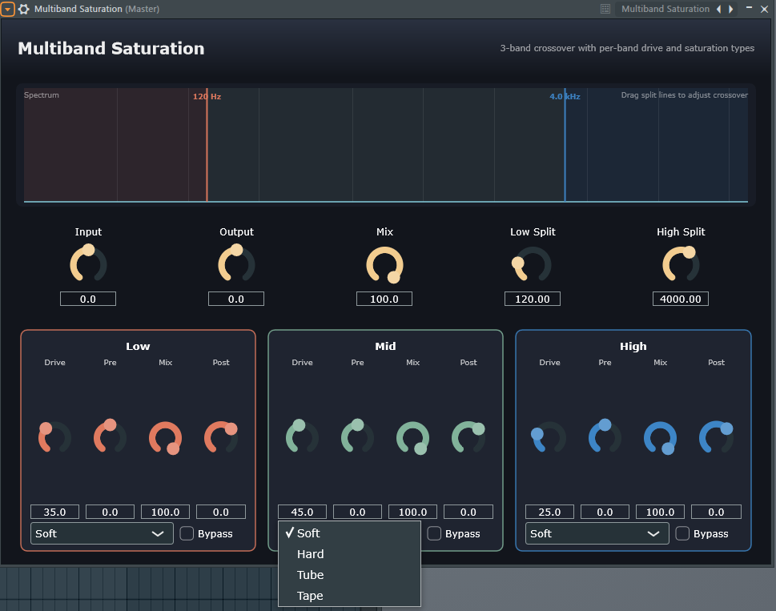

# Multiband Saturation



Multiband Saturation is a JUCE-based 3-band saturation audio plugin. It splits the incoming signal into Low, Mid, and High bands, then lets each band use its own drive amount, pre gain, wet/dry mix, post gain, saturation type, Solo, and Bypass controls.

It is designed for frequency-conscious color and density on drums, bass, buses, and full mixes.

## Features

- 3-band Linkwitz-Riley crossover: Low / Mid / High
- Drag-adjustable crossover lines in the spectrum display
- Global input gain, output gain, and dry/wet mix
- Per-band controls:
  - Drive
  - Pre gain
  - Band mix
  - Post gain
  - Saturation type
  - Solo
  - Bypass
- Built-in spectrum display for checking the band ranges
- Host-automatable parameters through `juce::AudioProcessorValueTreeState`
- Plugin state save and restore support

## Parameters

### Global

| Parameter | Default | Range | Description |
| --- | ---: | ---: | --- |
| Input | 0.0 dB | -24.0 dB to +24.0 dB | Input gain before the multiband split |
| Output | 0.0 dB | -24.0 dB to +24.0 dB | Output gain after band recombination |
| Mix | 100.0% | 0.0% to 100.0% | Global dry/wet mix |
| Low Split | 120.0 Hz | 20.0 Hz to 8000.0 Hz | Crossover between Low and Mid |
| High Split | 4000.0 Hz | 80.0 Hz to 16000.0 Hz | Crossover between Mid and High |

### Per Band

| Parameter | Range | Description |
| --- | ---: | --- |
| Drive | 0.0% to 100.0% | Amount of saturation drive |
| Pre | -24.0 dB to +24.0 dB | Gain before the saturation stage |
| Mix | 0.0% to 100.0% | Dry/wet mix for the current band |
| Post | -24.0 dB to +12.0 dB | Gain after the saturation stage |
| Type | Soft / Hard / Tube / Tape | Saturation curve |
| Solo | On / Off | Listen to one band in isolation |
| Bypass | On / Off | Skip saturation for the current band |

Default Drive values are Low 35%, Mid 45%, and High 25%, giving the plugin a light multiband coloration as soon as it is loaded.

## Saturation Types

- **Soft**: Smooth `tanh` saturation for natural thickening.
- **Hard**: Hard clipping for a more direct and aggressive edge.
- **Tube**: Asymmetric shaping with a slightly reduced negative half-cycle for tube-like harmonic color.
- **Tape**: A cubic-enhanced curve for gentle compression, density, and subtle texture.

## Build

This project uses a JUCE / Projucer project file:

```text
Multiband Saturation.jucer
```

The current exporter target is:

```text
Builds/VisualStudio2026
```

Build steps:

1. Install JUCE.
2. Open `Multiband Saturation.jucer` in Projucer.
3. Check that the module paths point to your local JUCE installation.
4. Save the project in Projucer to regenerate the exporter project if needed.
5. Open `Builds/VisualStudio2026/Multiband Saturation.sln`.
6. Select Debug or Release and build the plugin.

If your JUCE installation lives somewhere else, update the module paths in Projucer before building.

## Project Structure

```text
.
|-- Multiband Saturation.jucer
|-- README.md
|-- assets
|   `-- multiband-saturation-ui.png
|-- Source
|   |-- MultibandEngine.h       # Crossover, per-band processing, and global mix
|   |-- Parameters.h            # Plugin parameter definitions
|   |-- PluginEditor.cpp/.h     # Plugin interface
|   |-- PluginProcessor.cpp/.h  # Audio processor, state, and spectrum data
|   |-- Saturation.h            # Saturation algorithms
|   `-- SpectrumAnalyzer.cpp/.h # Spectrum display and crossover dragging
|-- Builds
|   `-- VisualStudio2026
`-- JuceLibraryCode
```

## Usage Tips

- For drum buses, try gentle Low drive, Tube or Tape in the Mid band, and lower Drive in the High band to avoid harsh cymbals.
- For bass, keep Low clean or lightly saturated, use Tube in the Mid band for translation, and add a small amount of Tape in the High band for texture.
- For mix bus use, lower the per-band Drive values and blend with the global Mix around 10% to 40%.
- Use Solo while setting crossover points, then turn it off to balance the full signal.

## Development Notes

The main DSP path lives in `Source/MultibandEngine.h`. The crossover uses `juce::dsp::LinkwitzRileyFilter<float>`, saturation curves are implemented in `Source/Saturation.h`, and parameters are managed through `juce::AudioProcessorValueTreeState`.

There are no automated tests in the project yet. Useful future tests could include saturation curve checks, crossover boundary behavior, parameter state save/restore, and offline render comparisons.
